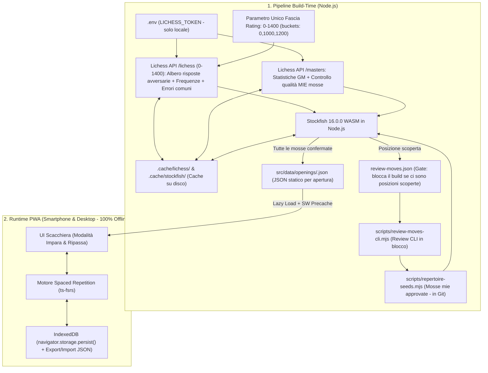

# ♟️ Chess Openings Trainer (PWA)

Applicazione web progressiva (**PWA**) **100% gratuita e funzionante offline** per studiare, esplorare e memorizzare un repertorio di aperture scacchistiche tramite **Spaced Repetition (FSRS)**, alimentata dai dati reali del **Lichess Opening Explorer** e validata a build-time con **Stockfish 16 WASM**.

---

## 🎯 Obiettivo del Progetto

Costruire uno strumento personale di allenamento sulle aperture (utilizzabile sia da **smartphone** installato sulla schermata Home sia da **browser desktop**) con basi scacchistiche ed ingegneristiche solide:
- **Zero "allucinazioni AI" sulle mosse**: nessuna mossa o statistica viene mai inventata da un modello linguistico.
- **Adattato agli avversari reali (Fascia `0-1400`) ma con mosse nostre da Maestro**: l'albero delle mosse avversarie riflette ciò che giocano davvero gli avversari nella fascia di rating target (`0-1400`), mentre le nostre risposte sono validate dal database **Lichess Masters (GM)** e da **Stockfish 16**.
- **100% Gratis e Senza Backend**: nessun costo di server, nessun database a pagamento, nessun rate-limit durante l'uso dell'app.

---

## 🏗️ Architettura e Scelte Ingegneristiche



### 1. Perché una Pipeline Static-First a Build-Time (Problema `HTTP 401` API Lichess)
L'endpoint `https://explorer.lichess.ovh` richiede autenticazione tramite Personal API Token (`Authorization: Bearer ...`), restituendo `HTTP 401` alle richieste anonime.
- **Nessun token nel frontend**: inserire un token personale nel client web lo esporrebbe pubblicamente e saturerebbe i rate-limit.
- **Soluzione**: lo script Node.js [`scripts/build-repertoire.mjs`](./scripts/build-repertoire.mjs) legge `LICHESS_TOKEN` da `.env` (ignorato da Git), interroga le API rispettando i rate-limit (`350ms` di pausa tra le chiamate, attesa automatica di `60s` su `HTTP 429`), salva tutto in cache su disco e genera file JSON statici divisi per apertura (`src/data/openings/caro-kann.json`).
- L'app React carica i JSON statici on-demand e il **Service Worker PWA** li mette in precache: l'app finale è **istantanea e funziona al 100% anche in modalità aereo**.

### 2. Ruolo Separato dei Due Database: Lichess `0-1400` vs Masters GM
Un giocatore con rating intorno a ~850 affronta mosse molto diverse da quelle giocate nei tornei tra Grandi Maestri:
- **Parametro unico di fascia (`RATING_BAND = 0-1400`, buckets API `0,1000,1200`)**:
  - L'endpoint `/lichess` filtrato sulla fascia `0-1400` determina **quali rami avversari esplorare**, le **frequenze reali delle risposte avversarie** e gli **errori comuni dell'avversario**.
  - Soglie esplicite di espansione: almeno **`MIN_BAND_GAMES = 5000`** partite nella fascia e frequenza minima nella posizione **`MIN_BRANCH_FREQ = 5%`**, fino a profondità **`MAX_MOVES_DEPTH = 8`** mosse (16 semimosse), con un tetto di sicurezza inderogabile **`MAX_POSITIONS_CAP = 150`** posizioni (se scatta il tetto si alzano le soglie, mai il tetto).
- **Database Masters (`/masters`) + Stockfish 16 (`stockfish@16.0.0`)**:
  - Usati **esclusivamente** quando tocca a noi muovere, per garantire che ogni nostra mossa sia teoricamente solida e accompagnata dalle statistiche reali dei Grandi Maestri.

### 3. Regola del Repertorio e Gate `review-moves.json`
Ogni nodo del grafo delle posizioni rispetta una regola rigorosa:
- **Quando tocca all'AVVERSARIO (`isPlayerTurn = false`)**: l'albero contiene **tutte** le risposte avversarie che superano le soglie nella fascia `0-1400`.
- **Quando tocca a NOI (`isPlayerTurn = true`)**: esiste **UNA SOLA mossa nostra** scelta per il repertorio.
- **Mai "la più frequente in automatico"**:
  1. Le nostre mosse approvate risiedono in [`scripts/repertoire-seeds.mjs`](./scripts/repertoire-seeds.mjs) (tracciato in Git).
  2. Se durante la scansione dell'albero viene raggiunta una posizione in cui tocca a noi non ancora coperta dai seed, lo script valuta le mosse candidate con **Stockfish (`depth 14`)**, filtra quelle **entro `0.30` pedoni** dalla mossa migliore del motore, le ordina per frequenza nel database Masters, le scrive in `review-moves.json` e **interrompe il build (`exit code 2`)**.
  3. Tramite la CLI [`scripts/review-moves-cli.mjs`](./scripts/review-moves-cli.mjs) si revisionano e confermano le scelte, che vengono salvate in `scripts/repertoire-seeds.mjs`.
  4. Inoltre, ogni nostra mossa già nei seed viene controllata con Stockfish: se perde più di **`0.50` pedoni** rispetto alla best move del motore, viene segnalata in `build-warnings.json`.

### 4. Doppia Cache su Disco (`.cache/lichess` e `.cache/stockfish`)
- **Cache Lichess (`.cache/lichess/`)**: indicizzata per endpoint, fascia di rating e FEN normalizzato.
- **Cache Stockfish (`.cache/stockfish/`)**: indicizzata per **`normalizedFen + depth + multipv`**. Rilanciare il build o rigenerare i report richiede `0` chiamate di rete e pochi millisecondi.

### 5. Errori Comuni dell'Avversario (`0-1400`) e Rivalutazione a `depth 20, multipv 2` *(Checkpoint B)*
- Per ogni posizione in cui tocca all'avversario, lo script analizza le mosse giocate nella fascia `0-1400` con frequenza **`>= 5%`**.
- **Screening + Deep Verification**: le mosse che mostrano una perdita di valutazione (`>= 0.40` pedoni) vengono **rivalutate obbligatoriamente a `depth 20, multipv 2`**; vale sempre la classificazione più profonda (`inaccuracy`: `0.40–0.99`, `mistake`: `1.00–2.49`, `blunder`: `>= 2.50`).
- **Ordinamento per impatto**: gli errori vengono ordinati per **`frequenza × perdita di valutazione`** (`frequencyPct * evalLoss`) tenendo al massimo i **primi 3 per posizione**, completi della nostra mossa punitiva e della linea principale del motore (**PV, max 6 mosse**).
- **Filtro UI**: nella modalità *Impara* vengono mostrati di default solo `mistake` e `blunder` (`>= 1.00` pedoni), mentre le `inaccuracy` (`0.40–0.99`) sono attivabili tramite il toggle *"Mostra imprecisioni"*.

### 6. Spaced Repetition con `ts-fsrs` e Chiavi FEN Normalizzate
- **Deduplicazione delle trasposizioni**: ogni card ha come chiave deterministica i primi 4 campi del FEN (`disposizione_pezzi turno diritti_arrocco casa_en_passant`), escludendo i contatori delle mosse. Ordini di mosse diversi che portano alla stessa posizione (es. `3.Nc3 dxe4 4.Nxe4` e `3.Nd2 dxe4 4.Nxe4`) puntano automaticamente alla **stessa card FSRS**.
- **Libreria ufficiale [`ts-fsrs`](https://github.com/open-spaced-repetition/ts-fsrs)** con regole rigorose:
  - **Uso del suggerimento (*Hint*)** → **`Rating.Again` SEMPRE**, senza alternative.
  - **Tentativo con mossa errata** → **`Rating.Again` SEMPRE**.
  - **Mossa corretta al 1° tentativo senza Hint** → **`Rating.Good`** di default, con possibilità di selezionare **`Rating.Easy`** dopo la risposta.
- **Limiti giornalieri**: massimo **`10` nuove card al giorno** (`MAX_NEW_CARDS_PER_DAY = 10`), di cui al massimo **`3` di tipo `"punish"`** (`MAX_NEW_PUNISH_PER_DAY = 3`), oltre a tutte le card in scadenza (`due`).

### 7. Storage Locale Persistente (`IndexedDB`) e Trasparenza Commenti AI
- **IndexedDB (`idb`) + `navigator.storage.persist()`**: tutti i progressi FSRS e i log delle sessioni sono salvati in IndexedDB (non `localStorage`), richiedendo al browser lo storage persistente per evitare la cancellazione automatica su iOS/Android, con funzioni di **Esporta / Importa Backup JSON** in un click.
- **Trasparenza AI**: tutti i dati numerici (mosse, frequenze, statistiche GM, valutazioni e PV) provengono esclusivamente da Lichess e Stockfish. Le brevi note strategiche in italiano sono confinate nel campo `aiCommentUnverified` e marcate chiaramente nell'UI con il badge **`⚠️ Commento AI, non verificato`**.

---

## 📂 Struttura del Progetto

```text
├── scripts/
│   ├── smoke-test-stockfish.mjs     # Smoke test Stockfish 16 WASM in Node (depth 14 su startpos)
│   ├── stockfish-runner.mjs         # Wrapper UCI Node.js con cache su disco (FEN + depth + multipv)
│   ├── repertoire-seeds.mjs         # Seed espliciti approvati (committato in Git)
│   ├── build-repertoire.mjs         # Pipeline di build statica con Lichess API + Stockfish
│   ├── review-moves-cli.mjs         # CLI per approvare in blocco o singolarmente review-moves.json
│   └── verify-caro-kann-report.mjs  # Report metriche repertorio + 10 campioni casuali verificabili
├── src/
│   ├── data/openings/
│   │   └── caro-kann.json           # Dataset statico generato per la Caro-Kann
│   ├── types/repertoire.ts          # Modello dati TypeScript
│   ├── services/
│   │   ├── fen.ts                   # Normalizzazione FEN (4 campi) e ID deterministici card
│   │   ├── srs.ts                   # Motore FSRS (ts-fsrs), regole rating e limiti giornalieri
│   │   └── storage.ts               # IndexedDB (idb), storage.persist() ed Export/Import JSON
│   ├── components/
│   │   ├── Dashboard.tsx            # Dashboard aperture, statistiche FSRS e backup JSON
│   │   ├── LearnMode.tsx            # Studio guidato con statistiche GM, rami 0-1400 ed errori comuni
│   │   └── ReviewMode.tsx           # Drill interattivo sulla scacchiera con FSRS
│   └── __tests__/
│       └── checkpointA.test.ts      # Test automatici Vitest (trasposizioni, FSRS, integrità JSON)
```

---

## 🚀 Comandi Principali

1. **Installazione dipendenze**:
   ```bash
   npm install
   ```
2. **Configurazione Token Lichess (solo per rigenerare il JSON statico)**:
   Copia `.env.example` in `.env` e inserisci il tuo token personale Lichess (`LICHESS_TOKEN=...`).
3. **Smoke Test Stockfish in Node.js**:
   ```bash
   npm run smoke:stockfish
   ```
4. **Build del Repertorio e Review Mosse**:
   ```bash
   npm run build:repertoire
   # Se vengono trovate nuove posizioni scoperte in review-moves.json:
   npm run review:moves -- --list
   npm run review:moves -- --accept-top
   ```
5. **Report di Verifica (Statistiche + 10 Campioni a Caso)**:
   ```bash
   npm run verify:caro-kann
   ```
6. **Test Automatici (`vitest`), Sviluppo e Build PWA**:
   ```bash
   npm test
   npm run dev
   npm run build
   ```

---

## 🗺️ Roadmap di Sviluppo

- [x] **Fase 1 — Checkpoint A**: Fetta verticale completa sulla **Caro-Kann** (*Variante di Spinta `3.e5 Bf5`* e *Variante Classica `4.Nxe4 Bf5`*), albero avversario `0-1400`, validazione GM + Stockfish, modalità *Impara*, modalità *Ripassa (FSRS)*, *Dashboard*, *Backup IndexedDB*, *PWA Offline* e report 10 campioni.
- [ ] **Fase 1 — Checkpoint B**: Estrazione errori comuni nella fascia `0-1400` (`>= 5%`), rivalutazione a `depth 20, multipv 2`, ordinamento per `frequenza × perdita`, pannello UI *Errori comuni* (con filtro imprecisioni) e card FSRS di tipo `"punish"`.
- [ ] **Fase 2**: Estensione del repertorio (**London System** col Bianco, **King's Indian Defence** col Nero e restanti varianti Caro-Kann), pannello Explorer statico, **Stockfish WASM single-thread** nel browser, modalità **Sparring** e **Import PGN**.
- [ ] **Fase 3 (Opzionale)**: Explorer live con token Lichess salvato localmente dall'utente ed eventuale sincronizzazione cloud.
